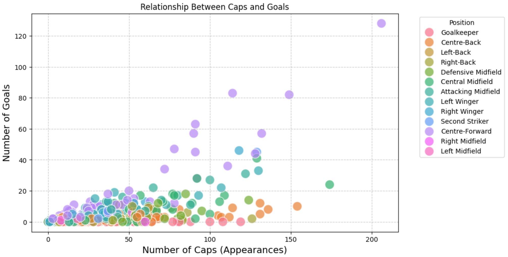
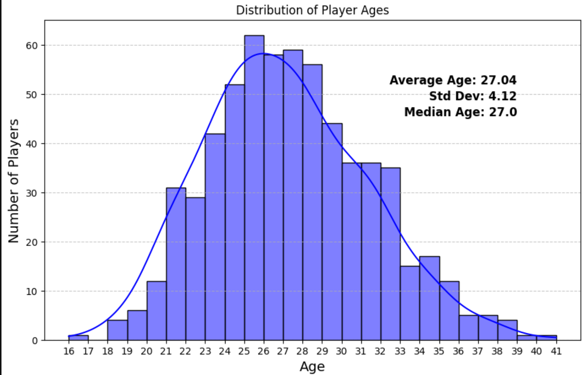
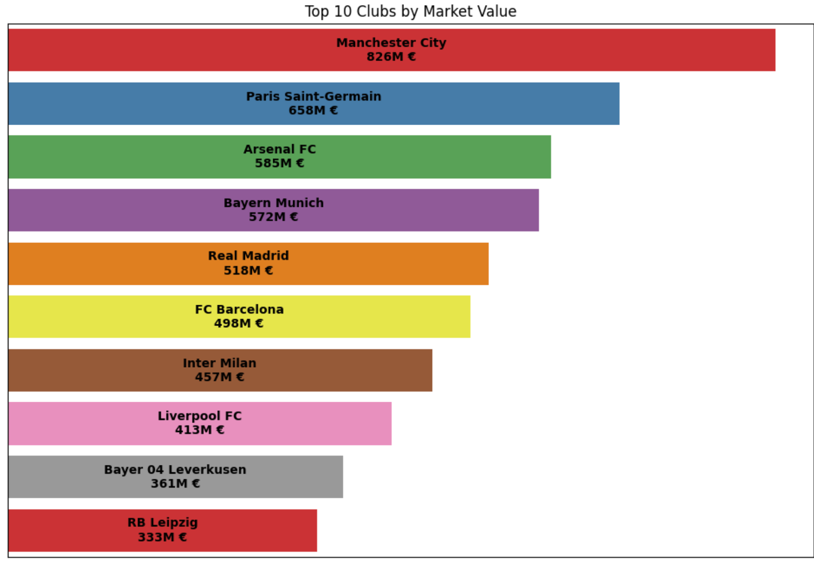
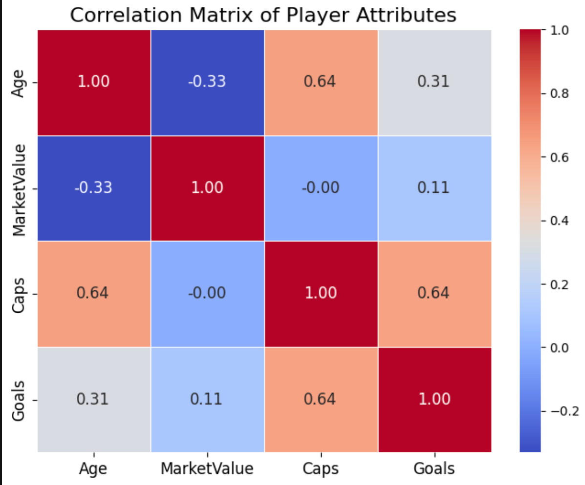

# UEFA Euro 2024 Player Analytics

Exploratory data analysis of the 623 players selected for UEFA Euro 2024, covering squad composition, international experience, player attributes, and estimated market value.

[](https://www.python.org/)
[](https://jupyter.org/)
[](https://pandas.pydata.org/)
[](https://seaborn.pydata.org/)

> A Data Analyst capstone project completed at John Bryce College.

[View the notebook](Euro2024_Player_Analysis.ipynb) · [Explore the dataset](euro2024_players.csv) · [Browse the visualizations](images)

## Project Overview

This project uses Python to examine the player profiles behind UEFA Euro 2024. The analysis moves from data quality checks and descriptive statistics to comparisons of player experience, physical attributes, position, country, club representation, and estimated market value.

The notebook demonstrates an end-to-end exploratory data analysis workflow:

1. Load and inspect the source data
2. Identify missing and placeholder values
3. Clean the preferred-foot field
4. Calculate descriptive statistics and grouped metrics
5. Build visualizations with Matplotlib and Seaborn
6. Compare squads and interpret the results

## Dataset

The analysis uses a static pre-tournament snapshot of the players selected for UEFA Euro 2024.

| Metric | Value |
|---|---:|
| Players | 623 |
| National teams | 24 |
| Clubs represented | 219 |
| Positions | 13 |
| Features | 10 |

The dataset includes:

- Player name, position, age, club, and height
- Preferred foot
- Senior international caps and goals
- Estimated market value
- National team

Source: [UEFA EURO 2024 – Players on Kaggle](https://www.kaggle.com/datasets/damirdizdarevic/uefa-euro-2024-players)

## Questions Explored

- Which players have the most international goals and caps?
- Which forwards have the highest goals-per-cap ratio?
- How do age, experience, goals, and market value relate?
- How are preferred foot and playing positions distributed?
- Which clubs contribute the most players and total market value?
- How do player height and market value vary by position?
- How do the England and Spain squads compare?
- What historical context can be added from previous Euro winners?

## Selected Findings

- The average player age is **27.04 years**, with ages ranging from **16 to 41**.
- The average estimated market value is approximately **€18.4 million**.
- **Jude Bellingham** and **Kylian Mbappé** have the highest listed market value at **€180 million** each.
- **Manchester City** leads the club-level total market value at approximately **€826 million**.
- Manchester City and Inter Milan each contribute **13 players**, the highest representation in the dataset.
- Caps and goals have a positive correlation of approximately **0.64**.
- Age and market value have a moderate negative correlation of approximately **-0.33**.
- Preferred-foot distribution is approximately **70.8% right**, **24.2% left**, and **5.0% both**.

## Visual Highlights

| Caps vs. goals | Player age distribution |
|---|---|
|  |  |

| Top clubs by total market value | Correlation matrix |
|---|---|
|  |  |

Additional charts in the [`images`](images) directory cover preferred foot, height by position, player market value, country and position comparisons, and club representation.

## Tools and Techniques

- **Python** for the analysis workflow
- **Pandas** and **NumPy** for cleaning, aggregation, and statistical calculations
- **Matplotlib** and **Seaborn** for data visualization
- Missing-value and placeholder detection
- Grouped aggregations and ranking
- Ratio and correlation analysis
- Comparative squad analysis
- Integration of supplementary historical data

## Repository Structure

```text
Python-Euro2024-Project/
├── Euro2024_Player_Analysis.ipynb  # Complete analysis and commentary
├── euro2024_players.csv            # Source player dataset
├── images/                         # Exported charts used in this README
└── README.md
```

## Run the Analysis

Clone the repository and create a virtual environment:

```bash
git clone https://github.com/GuyBar7/Python-Euro2024-Project.git
cd Python-Euro2024-Project
python -m venv .venv
```

Activate the environment:

```powershell
# Windows PowerShell
.\.venv\Scripts\Activate.ps1
```

```bash
# macOS or Linux
source .venv/bin/activate
```

Install the required packages and start Jupyter:

```bash
pip install jupyter pandas numpy matplotlib seaborn
jupyter notebook Euro2024_Player_Analysis.ipynb
```

Run the notebook from top to bottom with `euro2024_players.csv` in the repository root.

## Data Notes

- The dataset is a historical snapshot and is not updated automatically.
- `Caps` and `Goals` represent senior international career totals at the time of collection; they are not Euro 2024 match statistics.
- Market values are estimates captured at a particular point in time and should not be treated as current valuations.
- The notebook resolves three missing and three placeholder preferred-foot values during the cleaning stage.
- Conclusions describe patterns in this dataset and do not establish causation.

## Learning Outcomes

This project demonstrates practical experience in data cleaning, exploratory analysis, statistical summaries, grouped comparisons, visualization, and communicating findings from a real-world sports dataset.
